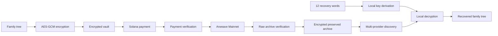

# SEJIRE

SEJIRE is a browser application for creating family trees, encrypting complete family archives, and recovering them independently of the original website.

## Current direction: independent Arweave release

The owner explicitly chose **Arweave-only operation on 27 November 2026**. The active branch is `feat/arweave-only-protocol-20261127`. Default `npm run web`, `npm run web:build`, and `npm run arns:build` select the independent `decentralized-direct-arweave` application. No production SEJIRE API, always-on host, server admin credential, centralized sponsor, Solana payment, or AO executor is required. Historical profiles require an explicit opt-in and remain for compatibility with earlier obligations.

New archives are signed by the family's compatible Arweave wallet and uploaded as native Arweave transactions. The user reviews the current **AR storage fee**; the former 0.03 SOL service fee and shared server promo code are not part of this release. Local editing and recovery remain free. Neither a public static password nor a browser-held treasury key is substituted for a secure sponsored protocol.

The archive and immutable site manifest can be accessed by their transaction IDs through replaceable gateways or a compatible user-selected node. `sejire.ar.io` is an optional friendly address: current ArNS ownership/resolution uses Solana, so the name is not described as an Arweave-only dependency. See the [official ArNS description](https://docs.ar.io/learn/arns).

Creating and editing a family tree, exporting a PDF, and downloading an encrypted recovery kit do not require a wallet. An on-chain save uses a durable local journal; a retry continues the same signed transaction. Completion requires both a confirmed header and the actual downloaded archive bytes. A transaction ID alone is insufficient.

The recovery kit contains the encrypted full vault, including all trees and history, and can be opened by the standalone tools in [`tools/recovery/`](tools/recovery/README.md). Recovery needs the encrypted file and its **SEJIRE archive words**; a wallet's recovery phrase is never requested. Recovery by a known native Arweave transaction ID additionally needs the network to serve its bytes. External media links do not embed those media in the archive.

**Source, an accepted static package, and a live deployment are separate states.** The November 27 architecture change requires its own exact-source CI and artifact verification. Earlier funded CI does not certify this new source. No new site publication or ArNS change has occurred. Native site-publication tooling uses a local persistent operation journal; its CI workflow prepares and quotes without wallet keys. A real compatible wallet round trip, public bytes/manifest checks and owner-approved name update remain live acceptance steps.

The former paid archive remains an unresolved historical obligation until its original bytes are recovered and verified. It is not replaced by a fresh payment. No always-on hosting signup or private legacy-ledger migration is required for the new independent application's runtime.

- [Independent release and owner acceptance](docs/INDEPENDENT_RELEASE.md)
- [Active protocol contract](docs/PROTOCOL.md)
- [November 27 architecture change and local audit](docs/verification/2026-11-27-arweave-only-transition.md)
- [Accepted Arweave-only package, complete CI and native price quote](docs/verification/2026-11-27-arweave-only-release.md) (evidence branch; accepted application source stays `ab06f2d1d78451533abfa48cfa18dc489df709d4`)
- [Open recovery format and offline decoder](tools/recovery/README.md)
- [Independent architecture and limits](docs/verification/2026-11-16-independent-arweave-architecture.md)
- [Current automated checks](https://github.com/azovskaya/sejire_arweave_solana/actions/workflows/checks.yml)

The existing funded/Solana implementation and its original journals remain in the repository for compatibility and unfinished earlier obligations. They are excluded from the independent static bundle. Do not delete the previous browser context, encrypted payload, signed transaction, or receipt while the earlier paid archive is still unresolved.

## Historical funded-profile reference

The sections below document the earlier Solana/Worker profile and its evidence. They do not describe the default independent release, and they do not authorize a new payment or deployment.

## Earlier verified Devnet reference run

An earlier owner-run technical pilot completed the following flow:

1. Create a family tree in the browser.
2. Encrypt the family vault locally with AES-GCM.
3. Verify an exact `0.03 SOL` payment on Solana Devnet.
4. Publish the encrypted archive to Arweave Mainnet.
5. Retrieve the raw archive and verify its size, SHA-256 digest, and vault identity.
6. Open SEJIRE in a clean browser.
7. Recover the family tree using only the 12 recovery words.

The admin overview also reads the Arweave save and verifies the finalized Solana payment through public read-only endpoints.

> This proves the technical workflow. It does not yet prove product-market fit, customer traction, or production pricing.

## Why Solana + Arweave

### Solana — practical payment and verification

SEJIRE uses Solana as the payment and coordination layer. It verifies:

- the network;
- transaction finality;
- the payer;
- the recipient;
- the exact amount;
- the deterministic preservation reference;
- the absence of unexpected value transfers.

Family names, dates, relationships, and recovery words are not written to Solana.

### Arweave — encrypted archive storage

Arweave stores the encrypted family archive independently of the SEJIRE interface.

SEJIRE does not mark preservation complete after receiving a transaction ID. It retrieves the raw archive again and verifies its integrity before showing completion.

### Browser cryptography — family-controlled recovery

The archive is encrypted before upload. The 12 recovery words remain with the family and are used locally to derive the decryption key and vault identifier.

## Architecture



Detailed architecture: [docs/colosseum/ARCHITECTURE.md](docs/colosseum/ARCHITECTURE.md).

## Live links

- Protocol: https://azovskaya.github.io/sejire_arweave_solana/
- Recovery: https://azovskaya.github.io/sejire_arweave_solana/#/restore
- Build provenance: https://azovskaya.github.io/sejire_arweave_solana/build-provenance.json
- Colosseum submission text: [docs/colosseum/COLOSSEUM_SUBMISSION.md](docs/colosseum/COLOSSEUM_SUBMISSION.md)
- Demo guide: [docs/colosseum/DEMO_GUIDE.md](docs/colosseum/DEMO_GUIDE.md)
- Prior-work disclosure: [docs/colosseum/HACKATHON_WORKLOG.md](docs/colosseum/HACKATHON_WORKLOG.md)
- Final checklist: [docs/colosseum/SUBMISSION_CHECKLIST.md](docs/colosseum/SUBMISSION_CHECKLIST.md)

## What existed before the hackathon

SEJIRE was an existing genealogy project before Crypto World's Fair. The pre-hackathon project already included:

- the family-tree editor;
- ancestor views;
- PDF and JSON export;
- client-side encryption;
- recovery concepts;
- earlier Arweave and AO experiments.

The original source and exact import baseline are disclosed in [HACKATHON_WORKLOG.md](docs/colosseum/HACKATHON_WORKLOG.md).

## What was built during the hackathon

The hackathon work added and hardened:

- Solana browser-wallet payment;
- deterministic payment references;
- strict finalized-payment verification;
- lost-response reconciliation and duplicate-payment prevention;
- the Preservation V2 state machine;
- real encrypted Arweave Mainnet preservation;
- post-upload raw-data verification;
- clean-browser recovery from 12 words;
- multi-provider and multi-gateway recovery;
- version-head and fork handling;
- password-protected admin diagnostics;
- network-based Arweave and Solana admin overview;
- public deployment, provenance, and browser-test coverage.

Only work completed during the contest period is presented as hackathon work.

## Team and contributors

### Alexey Azovsky — creator, developer, and official team lead

Alexey is an early-career software developer and a student at Tomorrow School. He graduated from the Faculty of Physics and Mathematics at Orenburg State Pedagogical University. He created SEJIRE and leads its product and technical development.

### Alisa Azovskaya — presentation and materials contributor

Alisa is Alexey's daughter. She helped prepare the Colosseum materials and record the English-language pitch and product-demo videos.

For the Colosseum submission, Alexey is the official entrant. Alisa is credited for presentation and materials support and is not listed as an official entrant.

## Run locally

Requirements:

- Node.js `22.12+`
- npm
- Git

```bash
git clone https://github.com/azovskaya/sejire_arweave_solana.git
cd sejire_arweave_solana

npm ci --prefix apps/web
npm ci --prefix apps/sponsor

npm test
npm run lint --prefix apps/web
npm run native:build
npm run dev --prefix apps/web
```

Automated tests use synthetic data and mocked wallets. They do not spend SOL, sign with the owner's wallets, or publish a new family archive.

## Verification

The release gate includes:

- TypeScript and lint;
- unit and protocol tests;
- Solana payment validation;
- Preservation V2 browser tests;
- admin-login browser tests;
- 22 clean-browser recovery scenarios;
- multi-gateway fallback;
- no-wallet/no-write recovery checks;
- public deployment smoke tests;
- build-to-published-SHA provenance.

Technical documentation:

- [Preservation V2](docs/PRESERVATION_V2.md)
- [Resilient recovery ADR](docs/adr/0009-resilient-vault-recovery.md)
- [Solana preservation](docs/SOLANA_PRESERVATION.md)
- [Security policy](SECURITY.md)

## Privacy and current limits

- Draft family data is stored locally in the browser and is not encrypted until the protected archive is created.
- The encrypted payload and limited technical metadata are public on Arweave.
- Solana wallet activity is public; SEJIRE does not claim payment anonymity.
- Losing the 12 recovery words can make the archive impossible to decrypt.
- The earlier verified end-to-end reference used Solana Devnet; it is not evidence of current Mainnet acceptance or production revenue.
- Mainnet pilot readiness requires verified archive bytes and clean-browser recovery after the accepted release is deployed.
- One owner-run technical pilot does not establish external demand.
- Shared family access and inheritance recovery remain future work.
- The static admin password gate protects the interface only; wallet signatures remain required for critical wallet operations.

## Repository map

| Path | Purpose |
|---|---|
| `apps/web` | React/TypeScript family-tree client, encryption, payment, preservation, and recovery |
| `apps/sponsor` | Cloudflare Worker, paid/promo checkout, durable continuation and Arweave delivery |
| `packages/checkout` | Payment amounts, orders, and state models |
| `packages/schema` | Family-tree and archive schemas |
| `ao` | Earlier AO protocol experiments |
| `docs/colosseum` | Submission, demo, work-log, and checklist materials |
| `docs/verification` | Reproducible technical evidence |

## License

MIT. See [LICENSE](LICENSE).

---

**SEJIRE — Pay with Solana. Preserve on Arweave. Recover with 12 words.**
